

  

  

  
  &nbsp;
  

 

## ⚡ About me

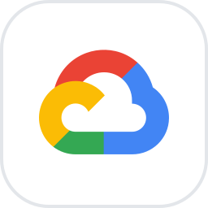

- 🤖 **AI Engineer & Sr. Data Analyst**: I build AI into the work. **AI agents** that run on **real business data**, and AI-generated features shipped to production.
- ☁️ Specialized in **Google Cloud**: BigQuery, Gemini, Vertex AI, **Google ADK** and Gemini Enterprise.
- 🔌 I build **MCP servers & clients** that connect LLMs to company data, metrics and dashboards.
- 📊 **4+ years in BI & analytics**: product & growth analytics, A/B testing, retention and conversion.
- 🏆 **Tableau Certified Consultant**.
- 🎓 Computer Engineering @ UADE · 🌎 Español · English · Italiano

 

## 🏆 Certification

  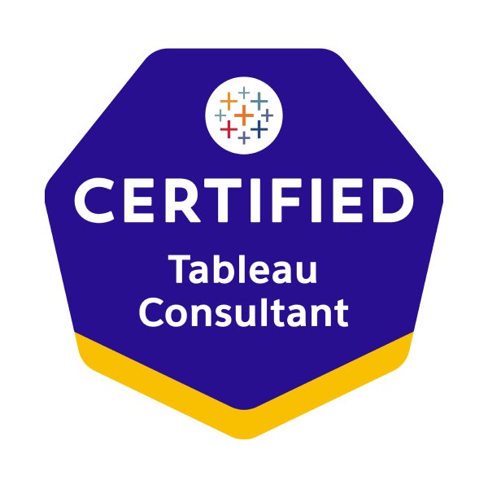
   
  <b>Tableau Certified Consultant</b>

## 📚 Courses

<table align="center">
  <tr>
    <td align="center" width="25%">
      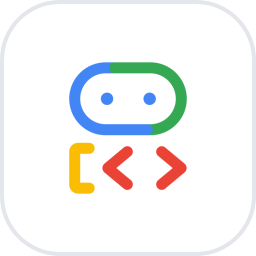 
      <b>Engineer AI Agents with Agent Development Kit (ADK)</b> 
      Google
    </td>
    <td align="center" width="25%">
      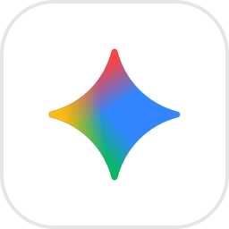 
      <b>Create Your First Gemini Enterprise Application</b> 
      Google
    </td>
    <td align="center" width="25%">
       
      <b>Data Analytics Tableau</b> 
      Tableau
    </td>
    <td align="center" width="25%">
      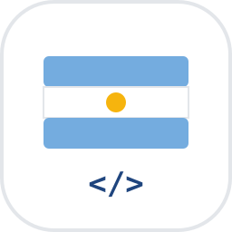 
      <b>Argentina Programa #YoProgramo</b> 
      Argentina Programa
    </td>
  </tr>
</table>

## 🧠 AI & Agents

  
  
  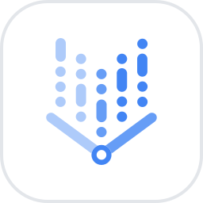
  
  
  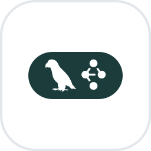
  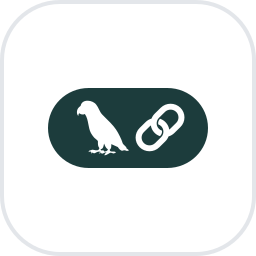
  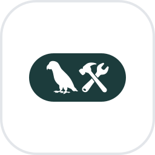
  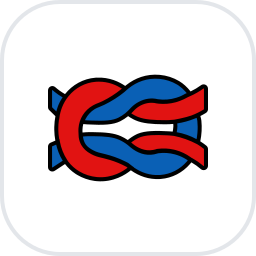
  

## ☁️ Google Cloud & Data

  
  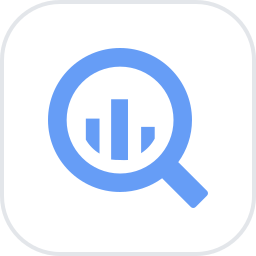
  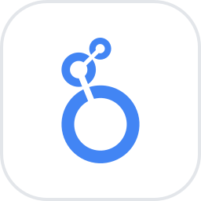
  
  
  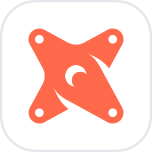
  
  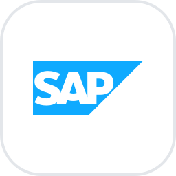
  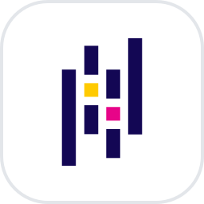
  

## 🛠️ Development & Deploy

  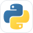
  
  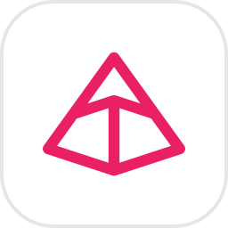
  
  
  
  
  
  
  
  
  

## 🚀 Featured project

<table align="center">
  <tr>
    <td valign="top">
      <h3><a href="https://github.com/dimaurizzio/memorIA">🧠 memorIA</a></h3>
      
AI-powered documentation for your team.

      
      
      
    </td>
  </tr>
</table>

  <i>Data tells the story. AI helps you hear it faster.</i> ✨

